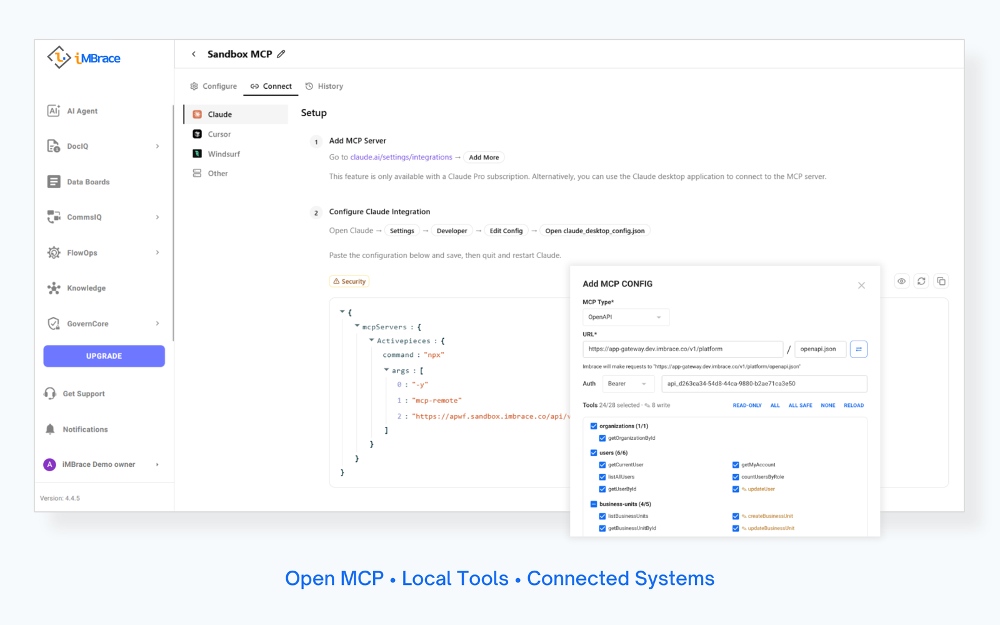

<p align="center">
  <a href="https://www.imbrace.co">
    
  </a>
</p>

<h1 align="center">iMBrace — Open-Source Enterprise AI OS</h1>

iMBrace Community Edition is a self-hosted, open-source AI Operating System built to keep your
company's intellectual property strictly on your infrastructure.

It gives developers and technical teams a transparent foundation to deploy context-aware AI
agents, stateful DAG workflows, and native MCP tool integrations—without sending sensitive
enterprise data to third-party clouds. Connect your local knowledge bases, route private LLMs,
and automate complex processes. When deployed with self-hosted models and storage, your data
stays inside your own environment. (Optional external providers such as OpenAI or Tavily, if
configured, send data outside your infrastructure.)

<p align="center">
  
</p>

---

## Key Capabilities

- **Data Sovereignty & Local Context:** Ingest unstructured data into local vector stores. Your
  intellectual property stays behind your firewall.
- **AI Agent Builder:** Deploy role-based agents powered by local LLMs (Ollama/vLLM) or private
  API endpoints with complete prompt transparency.
- **Stateful DAG Workflow Engine:** Orchestrate multi-step AI tasks, scheduled triggers, and
  communication webhooks over predictable execution paths.
- **Native MCP Gateway:** Expose internal tools, databases, and custom Python/Node scripts to
  agents using open Model Context Protocol standards.
- **Local System Telemetry:** Track execution paths, token consumption, and node latency in
  real-time. Export logs to Grafana/Prometheus.
- **Enterprise-Scale AI:** Scale beyond Community Edition with hybrid RAG and SQL, agent
  orchestration, enterprise access control, governance and auditability, multi-organization
  management, AI Copilot, and professional support.

---

## Quick start — run iMBrace with Docker Compose

The whole stack is one file: [`deploy/docker-compose.yml`](deploy/docker-compose.yml) —
21 containers plus 10 one-shot jobs (9 DB inits and the example seed), all from public
`docker.io/imbraceco` images and official base images (`amd64` + `arm64`, no registry token).

### ⚠️ Credentials — what `generate-env.sh` writes

`sh generate-env.sh` writes a random value per install into `.env` for every secret below.
`docker compose up` refuses to start until they are there.

| Credential                           | Default                                       | Where to change it                                                                                                                                                                                                               |
| ------------------------------------ | --------------------------------------------- | -------------------------------------------------------------------------------------------------------------------------------------------------------------------------------------------------------------------------------- |
| Dashboard admin login                | `admin@imbrace.co` / random per install     | `.env` → `ADMIN_EMAIL` / `ADMIN_PASSWORD` — **before the first start** (the admin is seeded once; if you later change the password in the UI, put the new one in `.env` too — the example seed logs in with it) |
| Workflow keys                        | random per install                            | `.env` → `AP_ENCRYPTION_KEY` (encrypts stored connection credentials), `AP_JWT_SECRET` (signs Workflow tokens)                                                                                                            |
| chat-ai keys                         | random per install                            | `.env` → `CHATAI_ENCRYPTION_SECRET_KEY` (encrypts stored LLM provider configs), `CHATAI_WEBUI_SECRET_KEY` (signs sessions)                                                                                                |
| ai-agent → chat-ai service key      | random per install                            | `.env` → `INTERNAL_SERVICE_KEY` (lets ai-agent read unmasked LLM provider keys and call DocIQ)                                                                                                                              |
| Garage S3                            | random per install                            | `.env` → `GARAGE_RPC_SECRET`                                                                                                                                                                                                |
| Postgres superuser +`imbrace` role | random per install | `.env` → `POSTGRES_PASSWORD` — **before the first start** (afterwards it needs an `ALTER ROLE`, since initdb only runs once) |
| Redis                                | random per install                            | `.env` → `REDIS_PASSWORD` — safe to rotate, Redis re-reads it on restart                                                                                                                                             |

Do not replace `AP_ENCRYPTION_KEY` or `CHATAI_ENCRYPTION_SECRET_KEY` on a running install:
stored Workflow connections / LLM provider configs become undecryptable. The script never
overwrites a key that is already in `.env`, and prints the dashboard login at the end.

`docker compose down -v` deletes all data volumes irreversibly — back up `pgdata` first.

### Requirements

Runs on **Linux** (`amd64` / `arm64`) and **macOS** (Apple Silicon or Intel) — every image
is multi-arch, so Apple Silicon runs natively without emulation.

|                 | Linux                                                                      | macOS                                                                                                                                          |
| --------------- | -------------------------------------------------------------------------- | ---------------------------------------------------------------------------------------------------------------------------------------------- |
| Docker          | Docker Engine 24+ with**Compose v2.23.1+**                           | Docker Desktop, OrbStack or Colima with**Compose v2.23.1+**                                                                              |
| Resources       | Recommended**8 cores / 24 GB RAM / 100 GB SSD**                      | Same, but given to Docker's VM:**Settings → Resources**, at least 16–24 GB memory and a 100 GB disk image (the defaults are too small) |
| Commands        | Prefix`docker` with `sudo` unless your user is in the `docker` group | No`sudo`                                                                                                                                     |
| `PUBLIC_HOST` | The server's IP or domain                                                  | `localhost` for this Mac only, or its LAN IP (`ipconfig getifaddr en0`) for other machines — then allow Docker in the macOS firewall      |

- The stack idles at ~7.5 GB RAM; too little RAM shows up as OOM-kills or a frozen host,
  not as a clear error.
- Inbound ports `6868`, `30700`, `30040`, `30030`, `30050`.
- No GPU: AI features use an **external** OpenAI-compatible endpoint
  (`VLLM_URL` / `LLM_PROVIDER` on `chat-ai` and `ai-agent`).
- On a Mac used as a server, disable sleep — the stack stops while the Mac sleeps.

### Deploy

The same commands work in a Linux shell and in the macOS Terminal (bash or zsh).

```bash
mkdir imbrace && cd imbrace
curl -fsSLO https://raw.githubusercontent.com/imbrace-co/iMBrace/main/deploy/docker-compose.yml
curl -fsSLO https://raw.githubusercontent.com/imbrace-co/iMBrace/main/deploy/generate-env.sh

sh generate-env.sh              # writes a random value per install into .env for every
                                # secret, including POSTGRES_PASSWORD / REDIS_PASSWORD, and
                                # prints the dashboard login (ADMIN_EMAIL=you@x sh ... for
                                # another email). Existing values in .env are never touched.

docker compose pull
docker compose up -d            # first start takes ~5 min
```

`PUBLIC_HOST` defaults to `localhost`: on the machine running the stack, open the dashboard
at `http://localhost:6868` or `http://127.0.0.1:6868`. The chat widget's full page
(`:30050/full_page.html`) has to be opened with the `PUBLIC_HOST` name itself, because its
iframe points there — to use `127.0.0.1` for it (or where `localhost` resolves to IPv6
first), set `PUBLIC_HOST=127.0.0.1`. To reach the stack from other machines, add the IP or
domain browsers use (no scheme, no port) to `.env` before `up`, e.g.
`echo PUBLIC_HOST=10.0.0.5 >> .env`.

Startup order is encoded in the file, so one `up -d` is enough. Back up `.env`: losing
`AP_ENCRYPTION_KEY` makes stored Workflow connections unrecoverable, losing
`CHATAI_ENCRYPTION_SECRET_KEY` does the same to the LLM provider configs.

> **Upgrading an install made from an earlier `docker-compose.yml`?** Before running
> `generate-env.sh`, put the values your install already uses into `.env`, so existing data
> still decrypts and the existing admin still logs in — the script then only fills in the rest
> (`INTERNAL_SERVICE_KEY`, `GARAGE_RPC_SECRET`, which are safe to replace):
>
> ```bash
> # plus AP_ENCRYPTION_KEY / AP_JWT_SECRET from the old .env (or old compose file)
> cat >> .env <<'EOF'
> ADMIN_PASSWORD=ChangeMe@12345
> CHATAI_ENCRYPTION_SECRET_KEY=imbrace2026
> CHATAI_WEBUI_SECRET_KEY=Ga9fImSJMCx5d9qLkRNwCQJ9I//573YWZ0zcl34n8pU=
> EOF
> ```
>
> Use the admin password you changed it to, if you did.

### Verify

```bash
docker compose ps               # *-db-init jobs: Exited (0); everything else: Up / healthy

. ./.env                        # loads ADMIN_EMAIL / ADMIN_PASSWORD
curl -s -X POST -H 'Content-Type: application/json' \
  -d "{\"email\":\"$ADMIN_EMAIL\",\"password\":\"$ADMIN_PASSWORD\"}" \
  http://<PUBLIC_HOST>:6868/api/platform/v1/login/authenticate     # returns a token
```

| URL                            | Content                     |
| ------------------------------ | --------------------------- |
| `http://<PUBLIC_HOST>:6868`  | Dashboard +`/api` gateway |
| `http://<PUBLIC_HOST>:30700` | Workflow automation         |
| `http://<PUBLIC_HOST>:30040` | AI agent (Next Best Action) |
| `http://<PUBLIC_HOST>:30030` | insightIQ AI chat           |
| `http://<PUBLIC_HOST>:30050` | Embeddable chat widget      |

### Try the example: two workflows that work together

The first `up -d` also installs the **customer-request** example
([`examples/customer-request`](examples/customer-request)): the one-shot `examples-seed`
service imports and enables two flows, and `customer-request-stub` (on `127.0.0.1:30800`)
stands in for the customer and the business system.

| Flow (FlowOps → Workflows)               | Started by                                       | What it does                                                                                                                                                                                                                                                                                    |
| ----------------------------------------- | ------------------------------------------------ | ----------------------------------------------------------------------------------------------------------------------------------------------------------------------------------------------------------------------------------------------------------------------------------------------- |
| **Customer request - intake**       | a service request with a`request_id`           | An AI agent classifies it, a code step finds the missing fields, the customer is asked for them, then the run**waits** (*Wait for Event*, key = `request_id`). After the reply it creates an approval task on the **Todos** page and, once approved, calls the business system. |
| **Customer request - reply router** | the customer's reply with the same`request_id` | *Resume Waiting Run*, key = `request_id`: hands the reply to the intake run waiting on that id, which carries on, and answers `202 resumed` — or `404 no waiting request` when no run waits on it.                                                                                     |

The `request_id` is the only link between the two flows. The waiting run is stored in
Postgres (no polling), so it survives `docker compose restart`, and a second reply for the
same id gets a `404` instead of resuming the run twice.

```
request ─► intake: classify ─ check fields ─ ask customer ─ ⏸ wait (request_id) ···▶ approval ⏸ ···▶ business system
reply ───► reply router: resume the run waiting on request_id ─────┘   (202 resumed / 404 nothing waiting)
```

**1. Give the example an AI model.** Dashboard → **LLM Provider** → add a provider (the
example is tested with Amazon Bedrock; for another type set `CLASSIFIER_PROVIDER_TYPE` /
`CLASSIFIER_MODEL` in `.env` first). Within 30 seconds the seed creates the AI agent
*Customer Request Classifier*, points the intake flow at it and exits:

```bash
docker compose logs examples-seed     # last line: "customer-request example is ready"
```

**2. Run both flows** — in the folder with `docker-compose.yml`, from bash, zsh, cmd or
PowerShell; nothing to install besides Docker. Use the same `request_id` in every step:

```bash
docker compose run --rm examples request REQ-1001   # intake: prints "Information required ..." and the AI classification; the run now waits
docker compose run --rm examples reply   REQ-1001   # reply router: HTTP 202 "resumed" (again: 404, nothing waits any more)
docker compose run --rm examples approve REQ-1001   # or Todos page → "Approve service request REQ-1001" → Mark as Approve
docker compose run --rm examples result  REQ-1001   # what the business system received: request, reply, classification, approval — one run_id
```

FlowOps → Workflows → **Runs** shows the intake run (*Paused* while it waits) with the
input and output of every step, and one reply router run per reply. `approve REQ-1001 Reject`
takes the rejection path instead.

To call the webhooks yourself, `docker compose run --rm examples urls` prints both URLs.
Send JSON with `content-type: application/json`: the request needs `request_id` (the example
treats `customer_name`, `email`, `address` and `preferred_date` as required), the reply the same
`request_id` plus the missing fields; add `/sync` to the reply router URL to get its
`202` / `404` answer. `SEED_EXAMPLES=false` in `.env` skips the example. More (bash scripts,
acceptance test, editing the flows): [`examples/customer-request/README.md`](examples/customer-request/README.md).

### Configuration (`.env`)

| Variable                                                       | Default                                           | Purpose                                                                                                                                                                                                     |
| -------------------------------------------------------------- | ------------------------------------------------- | ----------------------------------------------------------------------------------------------------------------------------------------------------------------------------------------------------------- |
| `PUBLIC_HOST`                                                | `localhost`                                     | Browser-facing IP/domain. Unset: use`localhost` or `127.0.0.1` on the same machine (`127.0.0.1` for the widget full page needs `PUBLIC_HOST=127.0.0.1`) — **required** for any other machine |
| `PUBLIC_SCHEME` / `WS_SCHEME`                              | `http` / `ws`                                 | Set`https` / `wss` behind a TLS proxy                                                                                                                                                                   |
| `AP_ENCRYPTION_KEY` / `AP_JWT_SECRET`                      | none —**required**                         | Workflow keys, written by`sh generate-env.sh`                                                                                                                                                             |
| `ADMIN_EMAIL` / `ADMIN_PASSWORD`                           | `admin@imbrace.co` / none — **required** | Dashboard admin, seeded on the first start only; written by`sh generate-env.sh`                                                                                                                           |
| `POSTGRES_PASSWORD`                                          | random per install, written by`sh generate-env.sh`                        | Postgres superuser and app role — changing it after the first start also needs an `ALTER ROLE`                                                                                                             |
| `REDIS_PASSWORD`                                             | random per install, written by`sh generate-env.sh`                        | Redis auth                                                                                                                                                                                                  |
| `INTERNAL_SERVICE_KEY`                                       | none —**required**                         | Shared by ai-agent and chat-ai (also DocIQ's API key); other callers only see masked LLM provider keys. Written by`sh generate-env.sh`                                                                    |
| `CHATAI_ENCRYPTION_SECRET_KEY` / `CHATAI_WEBUI_SECRET_KEY` | none —**required**                         | chat-ai provider-config encryption / session signing; written by`sh generate-env.sh`                                                                                                                      |
| `GARAGE_RPC_SECRET`                                          | none —**required**                         | Garage`rpc_secret` (64 hex chars); written by `sh generate-env.sh`                                                                                                                                      |
| `SEED_EXAMPLES`                                              | `true`                                          | `false` skips installing the example workflows                                                                                                                                                            |
| `CLASSIFIER_PROVIDER_TYPE` / `CLASSIFIER_MODEL`            | `bedrock` / `qwen.qwen3-32b-v1:0`             | LLM provider type and model of the example's AI agent                                                                                                                                                       |
| `GARAGE_KEY_ID` / `GARAGE_KEY_SECRET`                      | empty                                             | Garage S3 keys (optional bootstrap in the compose header)                                                                                                                                                   |
| `OPENAI_API_KEY` / `TAVILY_API_KEY`                        | empty                                             | Optional external providers                                                                                                                                                                                 |

### Operate

```bash
docker compose logs -f <service>
docker compose up -d            # after editing the file — only changed services restart
docker compose down             # stop, keep data
```

---

## License

iMBrace is licensed under the **[MIT License](LICENSE)** — free to use, copy,
modify, and distribute, including for commercial purposes.

Each component repository carries its own `LICENSE`. Repositories forked from
other open-source projects retain their upstream license (e.g. Activepieces and
OpenAuth under MIT, the chatbot under Apache-2.0, the chat workspace under
BSD-3-Clause) — check the `LICENSE` file in each repo.

---

## Repositories

### Frontend

| Repo                                                                    | Description                                   | Stack                                    |
| ----------------------------------------------------------------------- | --------------------------------------------- | ---------------------------------------- |
| [imbrace-fe](https://github.com/imbrace-co/imbrace-fe)                   | Main webapp — admin / member workspace       | Vite · React 18 · Redux Toolkit · PWA |
| [imbrace-chat-widget](https://github.com/imbrace-co/imbrace-chat-widget) | Embeddable chat widget (`<script>` drop-in) | Vite · React                            |

### Backend services

| Repo                                                    | Description                                                                   | Stack                          |
| ------------------------------------------------------- | ----------------------------------------------------------------------------- | ------------------------------ |
| [platform](https://github.com/imbrace-co/platform)       | Core platform — authentication, organizations, users, teams, SSO, licensing  | Hono · Drizzle · PostgreSQL  |
| [app-gateway](https://github.com/imbrace-co/app-gateway) | Self-hostable API gateway — auth, license verification, routing              | Node · Express · TypeScript  |
| [ai-agent](https://github.com/imbrace-co/ai-agent)       | AI agent runtime (backend + web client) — tools, MCP, chat orchestration     | Express · React · TypeScript |
| [chat-ai](https://github.com/imbrace-co/chat-ai)         | AI chat service — runs OpenAPI/MCP tool-servers                              | Open WebUI-based               |
| [channel](https://github.com/imbrace-co/channel)         | Omnichannel service — channels, conversations, contacts, webhooks, WebSocket | Hono · TypeScript             |
| [data_board](https://github.com/imbrace-co/data_board)   | Data-board management — data / CRM / knowledge / document boards             | Hono · Drizzle · PostgreSQL  |
| [file](https://github.com/imbrace-co/file)               | File service — upload, storage, presigned URLs                               | Hono · TypeScript             |
| [marketplace](https://github.com/imbrace-co/marketplace) | Apps / templates / integrations hub                                           | Node · TypeScript             |

### Workflow

| Repo                                              | Description                | Stack               |
| ------------------------------------------------- | -------------------------- | ------------------- |
| [workflow](https://github.com/imbrace-co/workflow) | Workflow automation engine | TypeScript · React |

---

## Working on the code

Each repository is self-contained and has its own README with setup instructions. Clone
the component you want to work on and follow its local README. A typical on-prem stack is
composed of the backend services above plus `imbrace-fe`.

[`deploy/docker-compose.yml`](deploy/docker-compose.yml) pins the currently published image
tag of every component, so it doubles as the reference for which versions are known to work
together. To run your own build of one service against the rest of the stack, drop a
`docker-compose.override.yml` next to it — Compose merges it automatically:

```yaml
services:
  data-board:
    image: my-local/data_board:dev
```

## Contributing

We welcome contributions. Please read:

- [CONTRIBUTING.md](CONTRIBUTING.md) — how to set up, branch, and open a PR.
- [CODE_OF_CONDUCT.md](CODE_OF_CONDUCT.md) — the standards we hold each other to.

## Security

To report a vulnerability, please **do not** open a public issue — email
`security@imbrace.co` (see [SECURITY.md](SECURITY.md)).
